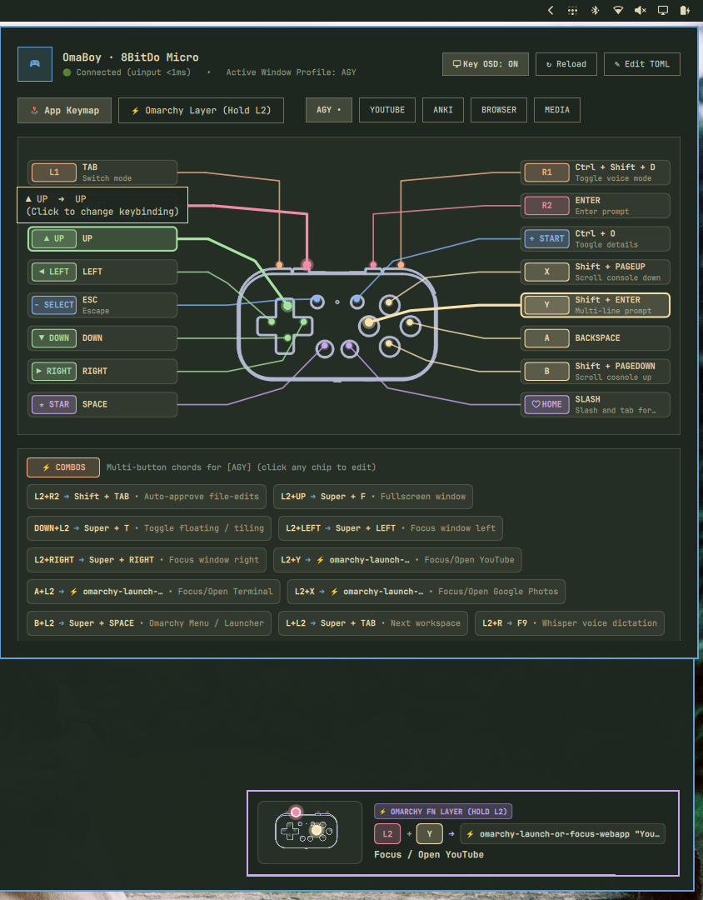

# OmaBoy 

**Use your 8bitdo micro/zero2 controller to control your Omarchy.**

**OmaBoy** is a native [Omarchy Quattro](https://plugins.omarchy.org/) status bar widget, interactive controller HUD, and live Key-Caster OSD overlay for the **8BitDo Micro** and **8BitDo Zero 2** pocket controllers, powered by [`8bitdo-micro-focus-switch`](https://github.com/DinuPhan/8bitdo-micro-focus-switch).



## Why?

I originally bought an 8BitDo Micro to play retro games on Omarchy, then realized this tiny controller fits in one hand and makes a great shortcut pad for coding in the terminal, watching YouTube, or reviewing Anki flashcards without touching my keyboard.

The catch with a pocket controller is that it only remembers one set of buttons at a time, and with 16 tiny buttons, it is easy to forget what each one does when you jump between apps. I built [`8bitdo-micro-focus-switch`](https://github.com/DinuPhan/8bitdo-micro-focus-switch) to handle the automatic profile switching in the background, and I built **OmaBoy** so I can see and change my controller buttons right from the Omarchy top bar.

## How it works

I split the setup into two small parts that talk to each other:

1. **`8bitdo-micro-focus-switch` (the translator running in the background)**:
   When you flip the 8BitDo Micro into Keyboard mode (`K`), the controller itself just sends basic letters whenever you press a button. My background CLI sits between the controller and your apps. It watches which window you are looking at and translates those button presses into the shortcuts that app expects. If I click on YouTube, pressing `A` sends `Space` to play or pause the video. If I click back to my terminal, pressing that exact same `A` button sends `Backspace`. I can also press two buttons together (like holding `L2` and tapping `Y`) to control Omarchy itself, like opening YouTube or switching workspaces.

2. **`OmaBoy` (this top-bar plugin)**:
   While the CLI does the translating behind the scenes, OmaBoy is what you see on screen:
   - A little controller icon (`󰊴`) in the top bar lights up as soon as I turn my 8BitDo Micro on, so I know it is connected.
   - Clicking that icon opens the visual HUD, which draws the controller and labels every button for the app I am currently using, so I never have to memorize my layout.
   - If I want a button to do something else, I click that button on the picture and press the new key on my keyboard. OmaBoy tells the CLI to save the change and apply it right away.
   - When I turn on **Key OSD**, a small popup in the bottom-right corner lights up whichever button I just pressed on the controller and shows the shortcut it triggered.

## Features

- **Live status bar indicator (`󰊴`)**: Lights up when your 8BitDo Micro or Zero 2 is connected over Bluetooth and dims when the controller goes to sleep.
- **Interactive controller HUD**:
  - Draws the 8BitDo Micro with color-coded lines to each button so you can read your layout at a glance.
  - Click any button card, pin, or combo chip to rebind it. You can capture a key directly from your keyboard, pick from common shortcuts, or type a custom command.
  - Switches views automatically to match your focused window (`agy`, `youtube`, `anki`, `browser`, `media`).
  - Includes a separate tab for your **Omarchy Global Layer**, where two-button chords control your window manager from inside any app.
  - Adapts its colors to both dark and light Omarchy themes so labels stay easy to read.
- **Live Key-Caster OSD overlay**:
  - Shows a small, click-through popup in the bottom-right corner whenever you press a button or combo on the controller.
  - Toggle it from the HUD header (`󰍹 Key OSD: ON / OFF`), with the `O` key inside the panel, or from the terminal (`omarchy-shell dinuphan.omaboy toggleOsd`).
- **Quick config controls**:
  - Press `R` to reload `~/.config/8bitdo-micro/profiles.toml` without restarting the background service.
  - Press `E` to open `profiles.toml` directly in your editor.

## Prerequisites & External Dependencies

OmaBoy reads controller status and profile mappings from [`8bitdo-micro-focus-switch`](https://github.com/DinuPhan/8bitdo-micro-focus-switch) (`MIT` license).

### Option A: Download Pre-compiled Binary (Recommended — Instant, 0 Compilation)

Download the standalone executable directly into `~/.local/bin/` and run setup:

```bash
curl -fsSL https://github.com/DinuPhan/8bitdo-micro-focus-switch/releases/latest/download/8bitdo-micro-focus-switch-linux-x86_64.tar.gz | tar -xz -C ~/.local/bin/
8bitdo-micro-focus-switch setup
```

### Option B: Build from Source with Cargo (Pinned Commit)

If you prefer compiling directly from source on Rust:

```bash
cargo install --git https://github.com/DinuPhan/8bitdo-micro-focus-switch.git --rev 43c9afece5bf70a436e89ad834467877955e9c67
8bitdo-micro-focus-switch setup
```

---

## Installation

Install via the Omarchy plugin CLI:

```bash
omarchy plugin add https://github.com/DinuPhan/omaboy.git --enable
```

Or validate and install from a local checkout:

```bash
omarchy plugin validate /path/to/omaboy
cp -r /path/to/omaboy ~/.config/omarchy/plugins/dinuphan.omaboy
omarchy-shell shell rescanPlugins
omarchy plugin enable dinuphan.omaboy --section right
```

---

## Removal

Disable or remove the plugin cleanly using the Omarchy plugin CLI:

```bash
omarchy plugin disable dinuphan.omaboy
omarchy plugin remove dinuphan.omaboy
```

Removing the plugin only deletes `~/.config/omarchy/plugins/dinuphan.omaboy` and leaves your `~/.config/8bitdo-micro/profiles.toml` configuration untouched.

---

## Keyboard & Mouse Shortcuts

- **Bar Icon Left-Click** (or `omarchy-shell shell toggle dinuphan.omaboy`): Open / close OmaBoy HUD panel
- **Bar Icon Middle-Click**: Cycle previewed app profile
- **Bar Icon Right-Click**: Reload `profiles.toml` (`SIGHUP`)
- **Inside Panel**:
  - `Left` / `Right`: Switch between app profiles (`AGY`, `YOUTUBE`, `ANKI`, `BROWSER`, `MEDIA`)
  - `Tab` or `L`: Toggle between **App Keymap** and **Omarchy Global Layer**
  - `O`: Toggle the on-screen **Key-Caster OSD Overlay** (`ON` / `OFF`)
  - `R` or `Enter`: Reload `profiles.toml`
  - `E`: Open `profiles.toml` in Omarchy editor
  - `Esc`: Close panel

---

## License

[MIT](LICENSE) © Nguyen Dinh Phan
